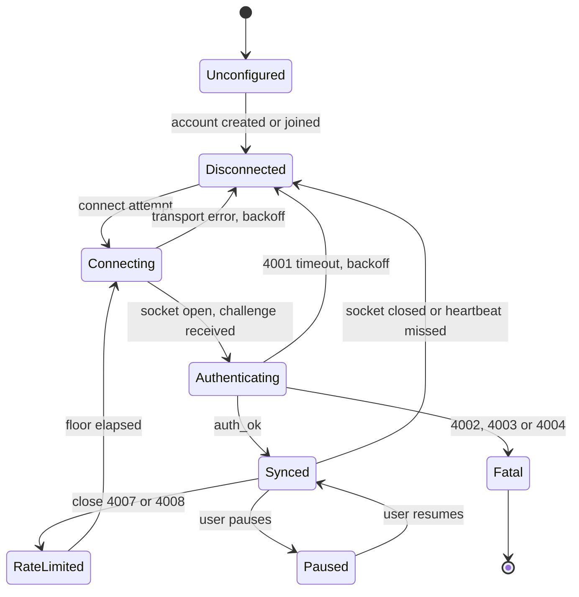

# Architecture

How Asli is put together, and why. The security design lives in `PROTOCOL.md` and
`THREAT_MODEL.md`; this document is about structure, threads and data flow.

> **Status.** Every crate exists and the relay is deployed. Text, images and files move between
> Linux, Windows 11 and macOS machines in daily use, against the live relay.

## 1. The shape of the system

```
   Device A                                Device B
   +--------------------------+            +--------------------------+
   |  asli-app (tray, UI)     |            |  asli-app                |
   |    +------------------+  |            |    +------------------+  |
   |    | asli-clipboard   |  |            |    | asli-clipboard   |  |
   |    |  Windows backend |  |            |    |  X11 backend     |  |
   |    |  macOS backend   |  |            |    |  Wayland backend |  |
   |    |  X11 backend     |  |            |    |  ...             |  |
   |    |  Wayland backend |  |            |    +--------+---------+  |
   |    +--------+---------+  |            |             |            |
   |             | ClipEvent  |            |             |            |
   |    +--------v---------+  |            |    +--------v---------+  |
   |    | asli-net         |  |            |    | asli-net         |  |
   |    |  state machine   |  |            |    |  state machine   |  |
   |    |  dedup and loop  |  |            |    |  dedup and loop  |  |
   |    |  protocol codec  |  |            |    |  protocol codec  |  |
   |    +--------+---------+  |            |    +--------+---------+  |
   |             |            |            |             |            |
   |    +--------v---------+  |            |    +--------v---------+  |
   |    | asli-crypto      |  |            |    | asli-crypto      |  |
   |    |  seal / open     |  |            |    |  seal / open     |  |
   |    +--------+---------+  |            |    +--------+---------+  |
   +-------------|------------+            +-------------|------------+
                 |  ciphertext over WebSocket TLS        |
                 +------------------+--------------------+
                                    |
                        +-----------v------------+
                        |  relay (Node, ws)      |
                        |  blind forwarder       |
                        |  room = hash(pub_key)  |
                        |  last clip, in memory  |
                        +------------------------+
```

The dedup and loop guards inside `asli-net` come from `asli-core`. Not drawn: files can also go
straight from one device to the other over TCP on the local network, sealed with `asli-crypto`,
without the relay (section 4.4).

The relay holds no secret, no database and no file. It routes ciphertext by room id, excludes the
sender, enforces quotas, and keeps at most the most recent small clip per room, which a device that
was switched off can ask for.

## 2. Crate layout

| Crate | Owns |
|---|---|
| `asli-crypto` | Key derivation, identity and room id, AEAD sealing and opening for clips, chunks and announcements, the handshake signature, per device keys and signed cards (`device`), join codes, approval and the sealed grant (`enroll`), the replacement key handed out on removal (`rekey`), file offers, answers and pieces (`file`), the key and framing of a direct transfer (`direct`), sealed device to device messages (`msg`), and the version a device reports (`about`). The retired join token parser is kept only to recognise and refuse old tokens. No I/O, no threads, no sockets. |
| `asli-core` | Content normalization, the echo guard and the replay guard. No I/O. |
| `asli-net` | The wire envelope, the handshake, the reconnect state machine and backoff, and the clip, chunk, announcement and `msg` paths over a WebSocket. |
| `asli-clipboard` | The `ClipboardWatcher` trait plus one backend per platform. All the operating system ugliness lives here and nowhere else. |
| `asli-dnd` | Files dropped on the window under Wayland, which winit does not handle there. The one crate with an `unsafe` call, kept apart so every other crate can forbid it. |
| `asli-history` | The local clipboard history, encrypted at rest under a key derived from the account key. |
| `asli-ui` | The compiled Slint markup for the window, kept apart so every hand written crate can forbid unsafe code. |
| `asli-app` | The `asli` binary (and `asliw` on Windows, which opens no console): command line, tray and menu, the window, configuration, keychain access, autostart, notifications, the single instance lock, the list of devices on the account and their pinned keys, joining and approval, removal by rekey, file transfer through the relay and directly on the local network, and the wiring between the rest. |
| `server/` | The Node relay. TypeScript, `ws`, in memory. |

The split exists for one practical reason: `asli-core` and `asli-crypto` have no I/O, so the
integration test can drive two headless clients against a real relay with no display server and no
clipboard. There is no hosted CI, by choice: the tests, format check and clippy are run locally,
and the platform behaviour is checked by running the app on each system.

## 3. Threading model

Shaped by platform constraints rather than preference.

| Thread | Runs | Why |
|---|---|---|
| Main | The Slint event loop and the window. On Windows and macOS also the tray icon and its menu | Every platform wants its user interface loop on the main thread. On Windows the tray's hidden window needs a thread that pumps messages, and macOS requires the main thread outright |
| Tray (Linux only) | Polls the tray and menu channels and refreshes the labels | The Linux tray is StatusNotifierItem over D-Bus, which runs its own service thread and needs no user interface loop |
| Clipboard watcher | Blocking platform event loop: the Windows clipboard listener, the macOS 500 ms poll, the X11 XFixes loop, the Wayland data-control loop | Each platform wants to own a loop. The watcher sends observations over a channel and never touches the network |
| Clipboard writer | Takes ownership of the clipboard for received clips, and on X11 and Wayland keeps serving it | X11 and Wayland have no clipboard storage, so whoever copied must answer every paste. Windows and macOS keep the data themselves, so there the writer only writes |
| Daemon | A current thread Tokio runtime: the WebSocket, TLS, reconnect timers, heartbeat | The socket is the main I/O |
| Short lived workers | Hashing a file before it is offered, each side of a direct transfer on the local network, joining and approving a device, and notifications that ask a question | Each blocks on a file, a socket or the person, and none of that may hold up the clipboard |

Communication is by channels, in one direction each way: the watcher sends local changes inward, and
the network task sends received clips outward to the writer. Nothing shares a lock across a platform
boundary.

The macOS main thread rule is the constraint that shapes the rest: the pasteboard poll runs on the
main thread with a timer tolerance, and hands its result to the core over a channel.

## 4. Data flow

### 4.1 A copy on this machine

1. The platform backend observes a clipboard change (an event on Windows, X11 and Wayland, a
   `changeCount` difference on macOS).
2. Debounce 100 ms, resetting on each further event, because one user copy routinely produces
   several change notifications.
3. Read the format or type list first. If a sensitive marker is present, stop here: the clip is not
   read, not hashed, not encrypted and not sent.
4. Read exactly the format we want, on a worker thread where the platform requires it.
5. Normalize: strip a UTF-8 BOM, strip a single trailing NUL, convert line endings to `\n`. Reject
   empty or whitespace only payloads.
6. Check the loop guards (section 5). If this is our own echo, stop.
7. Check the size cap. Over the cap means skipped with a visible notification, never a silent drop.
8. Build the inner plaintext (content type, device id, sequence number, timestamp, content), pad it
   to a bucket, and seal it with the epoch key. An image too large for one message is sealed as a
   run of chunks instead.
9. Send the public envelope to the relay. The relay broadcasts it to the other connections in the
   room and retains it if it is small enough.

### 4.2 A clip arriving from another machine

1. The network task receives an envelope and hands it to the core.
2. Reject a repeated `msg_id` (the dedup ring), a message older than the live window, a sequence
   number at or below the highest already seen from that device, or a message whose `device_id` is
   our own. A malicious relay can attempt all four.
3. Open the ciphertext. Failure is a single error with no detail, by design.
4. Seed the loop guard with the hash of the normalized content **before** writing to the clipboard.
   Order matters here: seeding after the write leaves a race that reopens the echo loop.
5. Convert line endings back to the platform convention and write to the clipboard.
6. Record the platform sequence anchor (`changeCount`, `GetClipboardSequenceNumber`, or our own X11
   selection ownership) so the resulting change event is recognised as ours.

### 4.3 A device announcing itself

1. On every successful handshake, and again whenever the relay reports a different connection
   count, the client seals an announcement holding its device id, its name and its operating
   system, and sends it.
2. The relay validates the envelope's shape, caps the ciphertext, drops a repeat of a message id
   it has already seen and forwards it to the other connections in the room. It never retains one
   and never lets one take a parked clip's place.
3. A receiver drops its own announcement, one whose timestamp is outside the clip window and one
   that fails to open, and otherwise records the name, the operating system and the time.
4. A device counts as online while this one is connected and has been heard from since the
   connection count last went down. Nothing reports a departure, so the device that does not
   answer a lower count is the one that left.

The list is kept in a small file beside the configuration (`devices.json`), tagged with the account
it belongs to, so "last seen two days ago" survives a restart and joining another account starts it
over. It also holds each device's public keys, pinned from its signed card, which file offers and
answers are checked against. The Home screen, the history's "from" line and file transfer read it.

### 4.4 A file sent to another machine

1. The sender hashes the file on a worker thread, then sends a signed offer to the one device it is
   for, as a sealed `msg` through the relay. If this machine has an address on a local network, the
   offer names it, and the sender listens on a port of its own while the offer waits.
2. The receiver checks the signature against the key it pinned for that device, and refuses an
   offer that is too old, from too far in the future, or made on a connection the sender has left.
   Otherwise it asks the person, and nothing more happens until they answer.
3. On Accept, the receiver tries the sender's local addresses for a moment. If one answers and the
   first piece opens under the key made for this transfer, the file comes over that TCP connection.
   If none answers, or nothing arrives within 15 seconds, the receiver answers through the relay
   and the file comes in sealed pieces as `msg` frames, which the relay forwards and never stores.
   With **Same Network Only** on, the relay is never used for the file, and the transfer fails
   instead.
4. The receiver writes to a partial file, checks the whole file's hash, and only then moves it into
   place. A transfer that stops moving for a minute is abandoned.

## 5. Loop prevention, in three layers

Each layer alone has a failure mode, so all three run. This lives in `asli-core`, not in
the platform backends, so the logic is tested once rather than four times.

1. **Origin id.** Every clip carries `device_id` inside the ciphertext. Drop anything with our own.
   This catches the case hashing misses: a reconnecting device that fetches the retained clip and
   would otherwise rebroadcast its own message.
2. **Content hash ring.** Twenty entries of the hash of the normalized payload, inserted just
   before we write a received clip to the clipboard, never when we send a local one, each expiring
   after 15 seconds (`asli-core`'s default, used by the session in `asli-net`). The app keeps a
   second ring of the same kind at the clipboard itself, with a 5 second TTL, so our own write is
   recognised before it is logged or recorded in the history. The TTL is the important part:
   without it, deliberately copying the same text twice stops working, which is a bug several
   competing tools have shipped.
3. **Platform sequence anchor.** Snapshot the operating system counter immediately after our own
   write and ignore the matching event. Available on Windows, macOS and X11. Wayland data-control
   has no owner field, so there only layers 1 and 2 apply.

## 6. Client state machine



Two rules that are properties of the machine, not of the code that happens to implement it:

- **Fatal is fatal.** Close codes 4002 (bad signature), 4003 (room does not match the key) and 4004
  (unsupported version) must not trigger a reconnect. A client retrying a bad signature every second
  against a public relay is a self inflicted denial of service.
- **Stability, not connection, resets backoff.** The attempt counter resets only after a connection
  has been authenticated and stable for 60 seconds, otherwise a server that accepts and immediately
  closes produces a tight loop.

Paused means the watcher keeps running but nothing is sent or applied, so the tray can say so
honestly rather than pretending to be offline.

## 7. Configuration and secrets

The keys and the configuration are stored separately, and only the keys go to the keychain: one
entry holds the account key followed by this device's own key, so macOS asks once rather than
twice.

| Platform | Secret | Configuration |
|---|---|---|
| Windows | Windows Credential Manager | `%APPDATA%\vnat\asli\config\config.json` |
| macOS | Keychain | `~/Library/Application Support/dev.vnat.asli/config.json` |
| Linux | Secret Service over D-Bus (pure Rust zbus) | `$XDG_CONFIG_HOME/asli/config.json`, default `~/.config/asli` |

The Linux case has a real failure mode that must be handled as a first class state rather than a
panic: a bare Hyprland or Sway session with no `gnome-keyring-daemon` and no `kwallet` running has
no Secret Service provider at all. The fallback is a file, `secret.key` in the configuration
directory. It is not encrypted: it is a plain file readable only by its owner (mode 0600 on Linux
and macOS; on Windows the profile's own access control), and `asli status` says when it is in use
and that it is weaker. See `THREAT_MODEL.md` for what that weakness actually means.

`config.json` holds `relay_url`, `max_content_bytes` (the largest clip to send), `notifications`,
`autostart`, `device_id`, `keep_history` and `history_entries`, `device_name` (what this device
announces to the others, empty meaning the computer's own name), `same_network_only`,
`ask_right_away` (whether a file offer is asked about at once rather than only on Home), and
`key_never_exported`, which records that this account's key was never shown in a retired join
token. It never holds key material. Beside it are `state.json` (the outgoing sequence number),
`devices.json`, `replay.json` (the replay guard's memory) and `history.bin`.

## 8. What is deliberately not here

- **No database.** Not on the client, not on the relay. The relay keeps one recent clip per room in
  memory and forgets it.
- **No synced history.** The history is local to each device and encrypted at rest. The relay
  never holds more than the one most recent clip.
- **No peer to peer for clips, and no discovery.** No mDNS, no NAT traversal, no libp2p. Clips
  always go through the relay. Files go directly over the local network only when the offer, which
  travels through the relay, names an address the receiver can reach; anything else falls back to
  the relay.
- **No plugin system, no scripting, no extension API.** The attack surface of a clipboard tool
  should be as small as its job.
- **No telemetry.** Nothing is collected, so there is nothing to opt out of.

## 9. Drawing the window

The window is drawn by Slint's **FemtoVG renderer** on OpenGL, on a platform window from winit. The
software renderer is built in as well, and Slint falls back to it by itself when no GL context can be
had: a virtual machine without 3D, a remote desktop session, a missing or broken driver. So the
window always opens, and looks its best wherever the machine allows.

The GPU renderer is what makes the design possible at all: real drop shadows and glows, gradients
and clipping that follow rounded corners, and smooth animation. The software renderer ignores drop
shadows, draws gradients and clips without their radius, and repaints only what changed, so
`SoftShadow` and `GradientFill` in `design.slint`, and thumbnails rounded in Rust, still exist to keep
the fallback presentable.

A closed window is never shown again: it is dropped at the next open and a new one built in its
place (`window::show`). The software renderer needed that on Windows, which discards a hidden
window's pixels while Slint kept believing its buffer was current, and it costs nothing on the GPU
path, so it stays for the fallback's sake.
